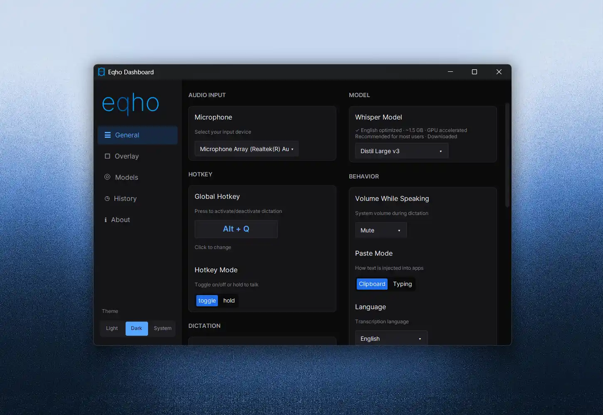

<picture>
  <source media="(prefers-color-scheme: dark)" srcset="logo/logo_horizontal_dark.png">
  <source media="(prefers-color-scheme: light)" srcset="logo/logo_horizontal_light.png">
  
</picture>

# Eqho — free, offline voice-to-text dictation

**Speak anywhere Windows lets you type.** Press a hotkey, talk, and your words appear in whatever app is focused — Word, your browser, Slack, code editors, anything. Rebuilt from the ground up in **Rust + Slint 1.19** around **[whisper.cpp 1.8.4](https://github.com/ggml-org/whisper.cpp)**, running **100% locally on your machine** — fast on NVIDIA, AMD, and Intel graphics cards via Vulkan, and fast on multi-core CPUs with compact quantized Q5 models.

[](https://www.gnu.org/licenses/agpl-3.0)
[%20%7C%20Linux%20%7C%20macOS-informational)](#install)

- 🔒 **Private by design** — no cloud, no account, no API key. Your voice never leaves your computer.
- ⚡ **Native Rust speed & tiny footprint (v0.9.0)** — **~14 MB** Windows installer (down from ~250 MB in the 0.8.x Python bundle), **~3.4 MB** idle RAM in the system tray, **~38 ms** tray startup, and **~0.25 s** Vulkan transcription on an RTX 3060 (42× real-time on a 10 s clip, no CUDA Toolkit required).
- 💻 **Works on any PC** — cross-vendor Vulkan GPU acceleration (NVIDIA, AMD, Intel) plus multi-threaded clean-PC CPU inference (**~0.7–1.5 s** on a 10 s clip with `tiny` / `base-q5`, zero VC++ Redistributable required) and 4 compact **Q5 quantized GGML models**.
- 🎛️ **Calm, focused UI & under-pill controls** — Deep Navy Blend dark mode and crisp light mode, hover-reveal or pinnable under-pill micro-bar (silent cancel `✕`, live timer, searchable 99-language menu with recent-language quick chips, **Batch / Live** toggle, pin, and Done `✓`) with zero focus stealing.
- 🌍 **99 languages with vector SVG flags** — honestly tiered (13 hand-tuned, 20 strong, 66 experimental) with sharp HiDPI vector flags and instant mid-dictation switching.
- 🆓 **Free & open source** — direct downloads from GitHub and source builds are 100% free under AGPL-3.0 with zero licensing code; an optional Microsoft Store edition with a 15-day free trial is also available for Store auto-updates and supporting development.



## Install

**Windows 10/11 (64-bit):**
- **GitHub Releases (free, open source):** grab `Eqho-Setup-0.9.5-win-x64.exe` (~14 MB, per-user, no admin prompt, zero VC++ Redistributable required) from [Releases](https://github.com/danielmevit/eqho/releases) → double-click → done. Prefer no installer? Use `Eqho-portable-0.9.5-win-x64.zip` (~29 MB).
- **winget:** `winget install eqho`
- **Microsoft Store (optional):** signed MSIX Store package with automatic updates and a **15-day free trial** (same local dictation engine, built with `--features store`).

**Linux x64 (free, open source — native Rust 0.9.5):**
- Grab `Eqho-0.9.5-linux-x64.AppImage`, `Eqho-0.9.5-linux-x64.deb` (Ubuntu/Debian/Mint), or `Eqho-0.9.5-linux-x64.tar.gz` from [Releases](https://github.com/danielmevit/eqho/releases) — bundles `whisper.cpp 1.8.4` with Vulkan GPU + 14 dynamic CPU ISA backends, PipeWire/PulseAudio mic capture, and X11 + GNOME Wayland support.

**macOS (Apple Silicon & Intel — native Rust 0.9.5):**
- Grab `Eqho-0.9.5-macos-arm64.dmg` (M1/M2/M3/M4: Metal GPU + Apple Accelerate + NEON) or `Eqho-0.9.5-macos-x64.dmg` (Intel: Metal + Accelerate + dynamic CPU ISA) from [Releases](https://github.com/danielmevit/eqho/releases). First launch of ad-hoc signed builds: right-click `Eqho.app` → **Open**, then grant Microphone & Accessibility permissions.

**Build from source (Windows x64, Rust 1.95+):**

```powershell
git clone https://github.com/danielmevit/eqho.git
cd eqho
cargo build --manifest-path rust/Cargo.toml -p eqho-app --release
```

Place the 13 `whisper.cpp 1.8.4` runtime DLLs (`whisper.dll`, `ggml.dll`, `ggml-base.dll`, `ggml-cpu-*.dll`, `ggml-vulkan.dll`) alongside `Eqho.exe`, or run `packaging\windows\build-rust.ps1 -DllDir <path>` (see [docs/rust/RELEASE.md](docs/rust/RELEASE.md) for clean-PC DLL build flags and Store MSIX packaging). First run opens a 6-step onboarding wizard and downloads your chosen GGML speech model — after that, everything works completely offline.

## How it works

1. Click into any app where you want text.
2. Press **Alt+Q** — the floating iridescent pill appears and listens without stealing focus.
3. Speak naturally. Hover the pill (or pin the under-pill bar open) to **cancel silently (`✕`)**, **switch between 99 languages live** via search or recent-language chips, or flip between **Batch** (paste all at once when you stop) and **Live** (deliver phrase by phrase as you speak).
4. Press **Alt+Q** again (or click **`✓`** on the under-pill bar) — your words land in the focused app, cleaned up and capitalized.

Toggle or hold-to-talk, your choice. The hotkey is customizable.

## Features

- **Dictation into any application** via private clipboard paste (excluded from Windows Win+V history) or simulated Unicode typing, with per-app paste rules and focus verification
- **Floating listening pill + under-pill micro-bar** — native Win32 per-pixel alpha glass pill that reacts to your voice, with a hover-reveal or pinnable action strip (`✕` silent cancel · live timer · searchable 99-language menu with dynamic recent chips · `Batch`/`Live` toggle · pin · `✓` Done), multi-monitor following, adjustable size/opacity, and optional Live Text Preview
- **Batch & Live delivery modes** — commit cleanly at the end of a session (**Batch**) or deliver phrase by phrase while speaking (**Live**), configurable in General → Behavior or directly from the under-pill bar
- **Settings dashboard** — **Deep Navy Blend** dark theme (`#1A489B` borderless primary fills, `#58A6FF` bright hairline accents, inset focus rings, and `#1A489B → #58A6FF` progress gradients), crisp light theme, and system theme
- **6-step first-run onboarding** — language picker with HiDPI vector SVG flags, live mic meter with device refresh, hardware-matched model picker with byte-level speed & ETA, audio ducking choice, and a live dictation readiness checklist
- **Model picker & Q5 CPU-fast models** — full-precision models (`tiny` through `large-v3`) plus 4 compact **Q5 quantized GGML models** (`Base Q5` 60 MB, `Small EN Q5` 190 MB, `Small Q5` 190 MB, `Large v3 Turbo Q5` 574 MB), alongside an **Inference Engine picker** (`Auto / GPU (Vulkan) / CPU`)
- **Transcript history** — searchable, date-filtered in your local timezone, exportable, stored locally, one-click clear
- **Custom vocabulary, text replacements & opt-in voice commands** — teach Eqho names and jargon, auto-fix recurring terms literally (safe for punctuation like `C++`), and optionally say "new line", "period", or "delete that"
- **Volume ducking** — quietly lowers or mutes other audio while you dictate without altering global Windows communications settings when disabled

## Languages

Whisper understands ~99 languages, with accuracy varying widely across them — so Eqho exposes **all 99, honestly tiered**, with crisp 4× HiDPI vector SVG flags:

- **Hand-tuned (13)** — tested in Eqho, dictation-grade: English · Spanish · Mandarin · Japanese · Korean · Vietnamese · Arabic · Ukrainian · French · German · Portuguese · Russian · Italian
- **Strong (20)** — strong published Whisper accuracy, lightly tested in Eqho: Dutch · Polish · Turkish · Swedish · Danish · Norwegian · Finnish · Czech · Romanian · Hungarian · Greek · Bulgarian · Croatian · Slovak · Catalan · Hindi · Indonesian · Malay · Thai · Hebrew
- **Experimental (66)** — everything else Whisper knows, from Afrikaans to Yoruba. Word-error rates vary widely — expect rough output and tell us how it goes.

Anything beyond English needs a **multilingual** model (`large-v3-turbo`, `large-v3-turbo-q5`, `small-q5`, `base-q5`, or `medium` in the Models tab) — English-only models (`.en` / `distil`) show an inline warning if paired with another language.

## Requirements

- **64-bit Windows 10 (1809+) / Windows 11** (primary, Rust 0.9.0; no 32-bit build — local AI models require 64-bit; zero VC++ Redistributable required)
- **Linux X11 / macOS** (legacy Python 0.8.x builds from Releases)
- **Optional GPU acceleration — auto-detected, zero extra runtime installs:**
  - **NVIDIA, AMD & Intel GPUs** — accelerated directly through Vulkan via `whisper.cpp` (no CUDA Toolkit download needed)
  - **CPU-only PCs & laptops** — clean-PC multi-threaded CPU DLLs (`GGML_OPENMP=OFF`, multi-ISA dispatch) paired with compact Q5 quantized models

## Platform notes

- **Windows (GitHub Releases):** unsigned installers show a SmartScreen prompt on first run — "More info" → "Run anyway". The optional Microsoft Store package is Store-signed and updates automatically.
- **Linux (0.8.x):** needs `libportaudio2`, `xclip`, and an AppIndicator library for the tray; global hotkeys and text injection target X11.
- **macOS (0.8.x):** grant Eqho **Accessibility** and **Input Monitoring** in System Settings → Privacy & Security; first launch of the unsigned app is right-click → Open.

## FAQ

**Is my audio uploaded anywhere?** No. Speech recognition runs 100% locally via `whisper.cpp` on your GPU or CPU. Network access is only used when you download a speech model (and, only if you explicitly opt in during setup or in Settings → Data & Trash, to send strictly anonymous usage stats to PostHog EU — never audio or dictated text).

**Does it cost anything?** Direct downloads from GitHub Releases, `winget`, and source builds are 100% free and open source under AGPL-3.0 with no trial, no word limits, and zero licensing code compiled in. If you prefer Microsoft Store delivery with automatic updates (or want to support Eqho), an optional paid Store edition includes a 15-day free trial.

**Does it work on AMD or Intel GPUs, or without a GPU?** Yes. On Windows, `whisper.cpp` with Vulkan accelerates NVIDIA, AMD Radeon, and Intel Arc/discrete GPUs out of the box. On PCs with integrated graphics or CPU only, Eqho runs multi-threaded CPU inference and recommends compact Q5 quantized models (`Base Q5` / `Small Q5`) for responsive local dictation.

**How accurate is it?** Whisper-class accuracy — measured at 1.39% WER on LibriSpeech reference clips with `large-v3-turbo` in **~0.25 s** (248 ms for a 10.4 s clip) on an RTX 3060, and **~0.7–1.5 s** on multi-core CPU with `tiny` / `base-q5`. Pick smaller Q5 models for speed or larger models for tougher audio.

**Where are my settings and history?** In your user config folder (`%APPDATA%\Eqho` on Windows) — never in the cloud.

## Configuration & docs

Settings persist to `settings.json` and history to `history.jsonl` in your config folder (compatible with `0.8.x` profiles). For architecture and build docs, see `AGENTS.md`, `docs/ai/START_HERE.md`, `docs/ai/BRAND_STYLE_GUIDE.md`, `docs/rust/PLAN.md`, `docs/rust/RELEASE.md`, and `CHANGELOG.md`.

## Under the hood

For the technically curious (the [website](https://eqho.damt.xyz/) stays non-technical on purpose):

- **Native Rust workspace (`rust/`):** Rust 1.95 (edition 2024) + **Slint 1.19** (`renderer-software` — zero idle GPU context, ~3.4 MB private RAM in tray, ~38 ms launch to tray ready) with `+crt-static` (PE-verified zero `VCRUNTIME140` / `MSVCP140` / `vcomp140` / `ucrtbase` runtime imports across `Eqho.exe` and all 13 bundled DLLs)
- **Out-of-process model host (`Eqho.exe --model-host`):** runs **[whisper.cpp 1.8.4](https://github.com/ggml-org/whisper.cpp)** in an isolated child process over IPC, so engine/model switches cleanly release VRAM and native driver faults never take down the tray or UI
- **Cross-vendor Vulkan + multi-threaded CPU:** clean-PC builds compile `whisper.cpp v1.8.4` with `-DCMAKE_POLICY_DEFAULT_CMP0091=NEW -DCMAKE_MSVC_RUNTIME_LIBRARY=MultiThreaded -DGGML_VULKAN=ON -DGGML_OPENMP=OFF -DGGML_CPU_ALL_VARIANTS=ON -DGGML_BACKEND_DL=ON` and load host-matched CPU ISA + Vulkan backends via `ggml_backend_load_all_from_path`; real confidence gating via `whisper_full_get_segment_no_speech_prob` and token log-probs
- **Audio & VAD (`eqho-platform-win` / `eqho-core`):** WASAPI capture supporting 16/24/32-bit integer PCM and 32-bit float at 16 kHz mono, self-calibrating adaptive VAD with bounded pre-roll ring buffer
- **Deterministic text pipeline (`eqho-core/src/textproc.rs`):** language-aware casing/spacing cleanup, opt-in voice commands, literal user replacements — never rephrases your words (no LLM touches your transcript)
- **Overlay (`eqho-overlay`):** native Win32 per-pixel alpha layered windows (`UpdateLayeredWindow` + `WS_EX_NOACTIVATE` / `MA_NOACTIVATE`) rendering the breathing iridescent pill, hover-reveal/pinnable under-pill action strip, searchable 99-language menu with dynamic recent chips, and upward-growing live preview panel without stealing focus
- **Packaging:** Inno Setup 6 LZMA2 installer (~14 MB), portable `.zip` (~29 MB), `winget`, and Microsoft Store `.msix` pipeline (`packaging/windows/AppxManifest.xml`, pure-ASCII `build_msix.ps1`, `generate_assets.py` + 48 PNG assets, compile-time `EQHO_STORE_ID` override)
- **Privacy & opt-in analytics:** off by default (`analytics_enabled: false`) and completely inert in community source builds without a build-time key. Official releases offer an explicit opt-in toggle sending strictly anonymous feature/hardware metadata to **PostHog EU (`eu.i.posthog.com`)** with `$process_person_profile: false` and `$ip: null` — voice audio, transcripts, filenames, window titles, and clipboard data are never transmitted.

## Development & AI disclosure

Eqho is designed, directed, tested on real hardware, and maintained by **Daniel Mitev ([damt.xyz](https://damt.xyz))** with extensive use of generative AI tools from start to finish — including application code, tests, documentation, packaging and CI automation, the website, store listing and marketing materials, and ongoing maintenance. Throughout, a real person steers the work and decides what is released.

This applies only to how Eqho is built and marketed. At **runtime**, Eqho does not connect to any cloud AI or generative LLM: speech recognition runs strictly locally via `whisper.cpp` on your own GPU or CPU, and text cleanup is 100% deterministic.

## License

Eqho is licensed under the [GNU AGPL-3.0](LICENSE): free to use, study, and modify — if you redistribute it or a derivative (including as a network service), you must keep the copyright and attribution notices and release your version under the same license. © [Daniel Mevit](https://github.com/danielmevit).

Made by **[damt.xyz](https://damt.xyz)** — freelance design & development.

Provided "as is", without warranty of any kind.

---

<sub><b>Keywords:</b> speech to text · voice to text · dictation software · offline speech recognition · free dictation app · voice typing for Windows · OpenAI Whisper app · whisper.cpp GUI · Rust dictation app · private speech to text · local voice recognition · no-cloud transcription · talk to type · voice keyboard · speech recognition without internet · dictate into any app · open source dictation · GPU accelerated transcription · Vulkan speech to text · AMD GPU dictation · AMD Radeon voice to text · Intel Arc dictation · Intel GPU speech recognition · cross-vendor GPU transcription · Whisper on AMD · real-time transcription overlay · hands-free typing · accessibility voice input · multilingual dictation</sub>
